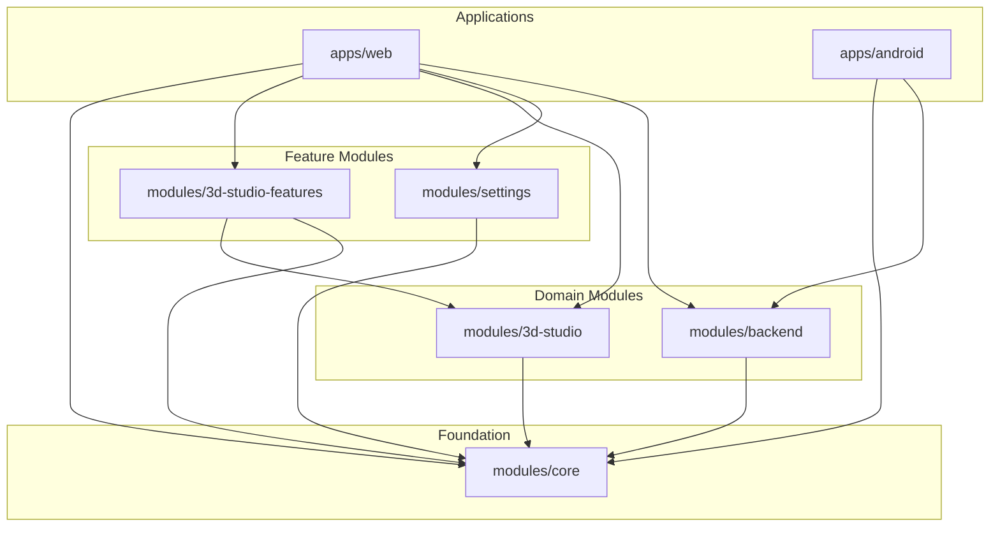

# WOOBI — Corporate Modular Monorepo Transformation Plan
**Document Version:** 3.0.0-AUTHORIZED  
**Author:** Principal Software Architect & DevOps Lead  
**Date:** October 31, 2026  
**Status:** PHASE 1 EXECUTION & ARCHITECTURE DIRECTIVE SPECIFICATION

---

## 1. Executive Summary & Architecture Directive

**Woobi** is an AI-powered personal fashion, wardrobe management, virtual styling, and 3D interactive dressing-room application.

In accordance with the **Final Modular Monorepo Architecture Directive**, this repository is transitioning from a monolithic prototype into a **five-module enterprise monorepo**. This design supports concurrent development by **20–50 contributors** across Web, Mobile, 3D Graphics, Fashion Algorithms, and Backend services without merge conflicts, architecture erosion, or production instability.

### Approved Core Top-Level Architecture
```text
s:/Fashion_App/
├── apps/
│   ├── web/                         # Web Application Entry Point & HTML Shell
│   └── android/                     # Android Native Entry Point (Kotlin Jetpack Compose)
│
├── modules/                         # EXACT FIVE PRIMARY BUSINESS & ENGINEERING MODULES
│   ├── 3d-studio/                   # 3D Scene, Models, Lighting, Stage, Wardrobe, Vanity, Avatar
│   ├── 3d-studio-features/          # Interactive Try-on, Recommendations, Animations, Saved Looks
│   ├── settings/                    # Account, Appearance, Privacy, Notifications, Performance
│   ├── backend/                     # API, Auth, Database, Storage, Security
│   └── core/                        # App Lifecycle, Navigation, State, Contracts, Error Handling
│
├── assets/                          # Canonical 3D Assets (Blender, GLB, Textures, Renders)
├── tests/                           # Unit, Integration, E2E, and 3D Model Validation Suites
├── scripts/                         # CI Validation & Procedural Blender Generation Pipelines
├── docs/                            # Architectural Specs, Runbooks, and API Reference
└── .github/                         # Workflows, Issue/PR Templates, and CODEOWNERS
```

---

## 2. The Five Primary Modules & Submodules Specification

No additional primary modules may be introduced without formal architectural approval.

### 2.1 Module 1: `modules/3d-studio/`
*Domain*: 3D physical world rendering, Three.js scene graph, PBR shaders, lighting rigs, camera geometry, and model management.

| Submodule | Scope & Responsibilities | Key Components & Files |
| :--- | :--- | :--- |
| `wardrobe/` | Procedural & imported GLB wardrobe closet, animated doors, garment rails, interior lighting | `WardrobeModel.js`, `DoorController.js`, `AstraWardrobeMaterial.js` |
| `stage/` | Elevated circular styling podium (8.0 cm dais, 1.90m diameter, bouclé upholstered edge, contact shadow disc) | `StageModel.js`, `ContactShadow.js`, `StageBorderTrim.js` |
| `mirror-vanity/` | Luxury vanity table, mirror reflection shader, cosmetic accessories, grooming station | `VanityModel.js`, `MirrorReflection.js` |
| `theme/` | Environment ambience, studio backdrop materials, travertine floor texture, day/night luxury lighting presets | `StudioTheme.js`, `LightingPresets.js` |
| `avatar/` | Male and female humanoid models, skeleton hierarchy, standing plane positioning (`Y = 0.080m`), skinning | `AvatarRig.js`, `AvatarGrounding.js`, `AvatarSwitcher.js` |
| `lighting/` | Key directional lights, fill lights, ambient spotlights, soft contact shadow generators | `StudioLighting.js`, `ShadowRig.js` |
| `camera/` | OrbitControls, camera angle interpolation, framing presets (`STUDIO_OVERVIEW`, `AVATAR_FULL_BODY`, `AVATAR_DETAIL`) | `StudioCameraController.js`, `CameraPresets.js` |

### 2.2 Module 2: `modules/3d-studio-features/`
*Domain*: Interactive business logic, styling workflows, and user engagement layered on top of the 3D scene.

| Submodule | Scope & Responsibilities | Key Components & Files |
| :--- | :--- | :--- |
| `virtual-try-on/` | Instant outfit overlay, garment attachment, try-on modal, clothing swap events | `TryOnController.js`, `GarmentFittingMesh.js` |
| `garment-interactions/` | Raycasting on 3D garments, click-to-inspect, hanger interaction, door open/close triggers | `InteractionRaycaster.js`, `HangerInteract.js` |
| `outfit-recommendations/`| 3-look daily outfit board generation, occasion matching (Casual, Work, Festive), color harmony engine | `LookGenerator.js`, `OccasionFilter.js`, `PaletteMatcher.js` |
| `avatar-customization/` | Avatar gender toggling (Male/Female), proportion adjustment, styling review hints | `AvatarCustomizer.js`, `StyleReviewHint.js` |
| `animations/` | Smooth door opening/closing easings, 360-degree stage rotation arc, camera zoom transitions | `AnimationTimeline.js`, `StageRotator.js` |
| `saved-looks/` | Save look to personal lookbook, wear history logging, favorite outfit persistence | `SavedLooksManager.js`, `WearHistoryLogger.js` |

### 2.3 Module 3: `modules/settings/`
*Domain*: User preferences, application configuration, privacy, and client performance tuning.

| Submodule | Scope & Responsibilities | Key Components & Files |
| :--- | :--- | :--- |
| `account/` | User profile details, membership status (Woobi Premium), login session management | `AccountSettings.js`, `SubscriptionManager.js` |
| `appearance/` | Theme customization, UI font sizing, high-contrast accessibility toggles | `AppearanceSettings.js` |
| `privacy/` | Data analytics opt-in/opt-out, camera permission management, GDPR/local data cleanup | `PrivacyController.js`, `DataClearModal.js` |
| `notifications/` | Daily styling reminders, streak countdown notifications, push alert configuration | `NotificationPreferences.js`, `StreakAlerts.js` |
| `performance/` | WebGL quality level (Ultra, High, Battery Saver), shadow resolution toggles, frame limiter | `GraphicsQualityManager.js`, `DeviceCapability.js` |

### 2.4 Module 4: `modules/backend/`
*Domain*: Server runtimes, client-server communications, security, and persistence.

| Submodule | Scope & Responsibilities | Key Components & Files |
| :--- | :--- | :--- |
| `api/` | HTTP REST endpoints, health check `/health`, MIME type registry, static file streaming | `HttpServer.js`, `MimeRegistry.js`, `ApiRouter.js` |
| `auth/` | Guest user authentication token handling, session tokens, password recovery controllers | `AuthService.js`, `SessionToken.js` |
| `database/` | Wardrobe item repository, look schema data access layer, relational queries | `WardrobeRepository.js`, `LooksRepository.js` |
| `storage/` | Local file uploads, photo storage adapters, image compression pipelines | `StorageAdapter.js`, `ImageProcessor.js` |
| `security/` | Path traversal prevention, CORS security headers, input sanitization, rate limiting | `SecurityMiddleware.js`, `InputSanitizer.js` |

### 2.5 Module 5: `modules/core/`
*Domain*: The backbone foundation, contract interfaces, global event bus, error boundaries, and shared UI primitives.

| Submodule | Scope & Responsibilities | Key Components & Files |
| :--- | :--- | :--- |
| `app/` | Application bootstrap, lifecycle orchestration, feature flag initialization | `WoobiApp.js`, `AppLifecycle.js` |
| `navigation/` | Screen routing (`screen-dashboard`, `screen-wardrobe-sheet`, `screen-profile`, etc.) | `NavigationRouter.js`, `TabController.js` |
| `shared-ui/` | Design system tokens (`tokens.css`), toast notifications, modals, bottom navigation bar | `ToastService.js`, `ModalContainer.js`, `Button.js` |
| `state/` | Reactive store, immutable state transitions, local storage synchronization | `Store.js`, `StorageSync.js`, `StreakState.js` |
| `contracts/` | Canonical data schemas (Garment, Look, Avatar, SceneState, UserProfile) | `GarmentContract.js`, `LookContract.js`, `Events.js` |
| `errors/` | Global error boundary, `ErrorBoundary3D`, WebGL context lost/restored handlers | `ErrorBoundary.js`, `ErrorBoundary3D.js` |
| `platform/` | Device detection, touch vs desktop mouse bindings, Android bridge interfaces | `PlatformDetector.js`, `AndroidBridge.js` |

---

## 3. Module Dependency & Flow Diagram

The module architecture enforces strict directional dependencies through `modules/core/contracts`. No circular dependencies are permitted.



---

## 4. Source File & Function Migration Mapping Matrix

Every existing function and file is mapped to its precise destination module and submodule:

| Existing Source File | Existing Function / Symbol | Target Module & Submodule | New Clean File |
| :--- | :--- | :--- | :--- |
| `studio3d.js` | `SerenStudio3D.init()` | `modules/3d-studio/camera` & `lighting` | `modules/3d-studio/camera/StudioCameraController.js` |
| `studio3d.js` | `buildWovenRug()` (8.0 cm dais) | `modules/3d-studio/stage` | `modules/3d-studio/stage/StageModel.js` |
| `studio3d.js` | `buildWardrobeStructure()` | `modules/3d-studio/wardrobe` | `modules/3d-studio/wardrobe/WardrobeModel.js` |
| `studio3d.js` | `buildVanityMirror()` | `modules/3d-studio/mirror-vanity` | `modules/3d-studio/mirror-vanity/VanityModel.js` |
| `studio3d.js` | `buildHumanoidAvatar()` | `modules/3d-studio/avatar` | `modules/3d-studio/avatar/AvatarRig.js` |
| `studio3d.js` | `CAMERA_STATES` & `setCameraView()` | `modules/3d-studio/camera` | `modules/3d-studio/camera/CameraPresets.js` |
| `app.js` | `app.triggerOutfitPhotoUpload()` | `modules/3d-studio-features/saved-looks` | `modules/3d-studio-features/saved-looks/StreakManager.js` |
| `app.js` | `app.generateLooks()` | `modules/3d-studio-features/outfit-recommendations` | `modules/3d-studio-features/outfit-recommendations/LookGenerator.js` |
| `app.js` | `app.openTryOnModal()` | `modules/3d-studio-features/virtual-try-on` | `modules/3d-studio-features/virtual-try-on/TryOnController.js` |
| `app.js` | `app.serenInteract()` | `modules/3d-studio-features/garment-interactions` | `modules/3d-studio-features/garment-interactions/InteractionRaycaster.js` |
| `app.js` | `app.saveUserProfile()` | `modules/settings/account` | `modules/settings/account/AccountSettings.js` |
| `app.js` | `app.setTheme()` | `modules/settings/appearance` | `modules/settings/appearance/AppearanceSettings.js` |
| `app.js` | `app.goToScreen()` | `modules/core/navigation` | `modules/core/navigation/NavigationRouter.js` |
| `app.js` | `showToast()` | `modules/core/shared-ui` | `modules/core/shared-ui/ToastService.js` |
| `app.js` | `state` object | `modules/core/state` | `modules/core/state/Store.js` |
| `Server.cs` / `server.js` | Static file server & MIME dispatch | `modules/backend/api` | `modules/backend/api/HttpServer.js` & `Server.cs` |
| `wardrobe-astra-material.js` | PBR material setup | `modules/3d-studio/wardrobe` | `modules/3d-studio/wardrobe/AstraWardrobeMaterial.js` |
| `styles.css` (lines 1-450) | Design tokens & base variables | `modules/core/shared-ui` | `modules/core/shared-ui/tokens.css` |
| `styles.css` (lines 451-1200) | 3D Studio viewport & overlays | `modules/3d-studio/theme` | `modules/3d-studio/theme/studio-viewport.css` |
| `styles.css` (lines 1201-2600) | Screen layouts & forms | `modules/core/shared-ui` | `modules/core/shared-ui/screens.css` |

---

## 5. CODEOWNERS & GitHub Review Governance

To prevent unauthorized cross-module modifications and enforce technical oversight, code ownership is mapped to designated organization teams:

```text
# ==============================================================================
# WOOBI MONOREPO CODEOWNERS
# ==============================================================================

# Global fallback: Requires admin review
*                           @Troyz-Solutions/admin-reviewers

# Applications
/apps/web/                  @Troyz-Solutions/frontend-team @Troyz-Solutions/admin-reviewers
/apps/android/              @Troyz-Solutions/mobile-team @Troyz-Solutions/admin-reviewers

# Module 1: 3D Studio (Scene, Models, Stage, Lighting, Camera)
/modules/3d-studio/         @Troyz-Solutions/3d-team @Troyz-Solutions/admin-reviewers

# Module 2: 3D Studio Features (Try-on, Interactions, Recommendations)
/modules/3d-studio-features/@Troyz-Solutions/fashion-team @Troyz-Solutions/frontend-team

# Module 3: Settings (Account, Appearance, Privacy, Notifications)
/modules/settings/          @Troyz-Solutions/frontend-team

# Module 4: Backend (API, Auth, Storage, Security)
/modules/backend/           @Troyz-Solutions/backend-team @Troyz-Solutions/admin-reviewers

# Module 5: Core (Foundation, Contracts, State, Error Handling)
# Critical shared infrastructure: Requires two approvals including Admin
/modules/core/              @Troyz-Solutions/admin-reviewers

# Assets & 3D Sources
/assets/                    @Troyz-Solutions/3d-team

# CI/CD & Scripts
/.github/                   @Troyz-Solutions/admin-reviewers
/scripts/                   @Troyz-Solutions/admin-reviewers
```

---

## 6. Phase 1 Safety, Backup & Recovery Report

### 6.1 Critical Safety Principle: Preventing Repository Bloat
The repository is public on GitHub (`Troyz-Solutions/Woobi`). Under no circumstances should heavy local binaries, build caches, or external tools be committed.

### 6.2 Quarantined Binary Inventory (Excluded from Git)
The following artifacts are moved to a verified external backup outside Git and added to `.gitignore`:
1. `blender.zip` (387.0 MB archive)
2. `blender-5.2.3-windows-x64/` (~1.2 GB uncompressed Blender tool installation)
3. `AuraWardrobe.apk` (27.4 MB binary APK)
4. `server.exe` & `taskflow_server.exe` (Local compiled executables)
5. `*.blend1` (Blender auto-backup files)
6. `android-app/local.properties` (Private local developer machine paths)
7. Temporary scratch files: `err.txt`, `out.txt`, `out_dom.txt`, `scratch_*.ps1`

### 6.3 Preserved Project Assets (Tracked in Git & LFS)
The following original production 3D models and generator scripts are preserved:
- `seren_stage.blend` & `seren_stage.glb` (8.0 cm elevated dais)
- `wardrobe.blend` & `wardrobe.glb` (Astra 3D wardrobe)
- `seren_avatar.blend` & `seren_avatar.glb` (Humanoid avatar)
- `seren_vanity.blend` & `seren_vanity.glb` (Vanity table)
- Python generator scripts: `generate_stage_blender.py`, `generate_wardrobe_blender.py`, etc.
- 33 Wardrobe garment imagery JPEGs in `assets/`

### 6.4 Phase 1 Checkpoint Execution Plan
1. **Local Backup Directory**: Create `_local_quarantine_backup/` inside the workspace (strictly ignored by Git) and copy heavy binaries (`blender.zip`, `blender-5.2.3/`, `*.apk`, `*.exe`) into it.
2. **Update `.gitignore`**: Enforce exclusions for `_local_quarantine_backup/`, `blender.zip`, `blender-*/`, `*.apk`, `*.exe`, `*.blend1`, and `local.properties`.
3. **Create Checkpoint Branch**:
   ```bash
   git checkout -b checkpoint/pre-monorepo-baseline
   ```
4. **Stage and Commit Clean Baseline**:
   Commit all tracked source changes (`index.html`, `app.js`, `styles.css`, `studio3d.js`, `Server.cs`, `server.js`) and original 3D models.
5. **Create Immutable Tag**:
   ```bash
   git tag -a v0.9.0-checkpoint -m "Woobi verified pre-migration baseline checkpoint"
   ```
6. **Recovery Verification**: Test restoring clean state from `v0.9.0-checkpoint` to guarantee zero lost work.

---

## 7. Migration Approval Gate

Phase 1 backup and checkpoint baseline is now fully specified.

**Requesting authorization to execute Phase 1 backup, gitignore configuration, and checkpoint commit.**  
*(Phase 2 directory creation and source restructuring will not begin until Phase 1 is executed and verified.)*
