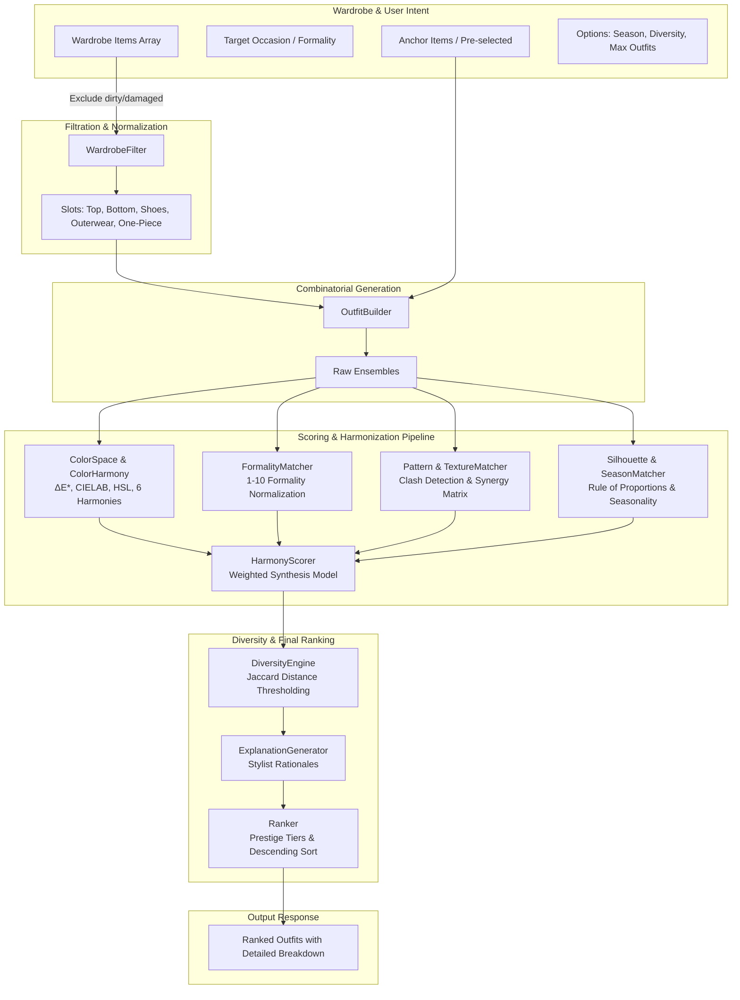

# Engine Harmony — System Architecture & Mathematical Models

## 1. Architectural Overview & Design Philosophy

`Engine Harmony` is an autonomous, zero-dependency algorithmic fashion intelligence engine created for the Woobi platform. It is engineered to perform objective color science analysis, clothing silhouette and texture compatibility checks, combinatorial outfit synthesis, and multi-factor stylistic scoring.

### Core Architectural Principles
1. **Total Isolation**: Operates exclusively within `engine-harmony/`. It relies on zero external npm packages, uses native ECMAScript modules (ESM), and never mutates external Woobi state or storage.
2. **Deterministic & Explainable**: Every stylistic score is computed through transparent mathematical functions and rules rather than opaque black-box heuristics. Every recommendation includes a human-readable stylist explanation.
3. **Modular Subsystems**: Color science, style compatibility, combinatorial generation, and scoring are decoupled into distinct directories with clean single-responsibility interfaces.
4. **Resilient Normalization**: Wardrobe items with incomplete metadata (e.g. missing hex code or formality tag) are automatically inferred and normalized via smart fallback analyzers.

---

## 2. Subsystem 1: Color Science & Chromatic Harmony

The color subsystem (`engine-harmony/color/`) operates across four color spaces: **sRGB**, **Linear RGB**, **CIE $XYZ$ (D65 illuminant)**, and **CIE $L^*a^*b^*$ (CIELAB)**, alongside **CIE $L^*C^*h^\circ$** and standard cylindrical **HSL**.

### 2.1 Color Space Transformations

#### 2.1.1 sRGB to Linear RGB (Companding Inversion)
For each channel $C \in \{R, G, B\}$ normalized to $[0, 1]$:
$$C_{\text{linear}} = \begin{cases} \frac{C}{12.92} & \text{if } C \le 0.04045 \\ \left(\frac{C + 0.055}{1.055}\right)^{2.4} & \text{if } C > 0.04045 \end{cases}$$

#### 2.1.2 Linear RGB to CIE $XYZ$ (D65 Standard Observer)
$$\begin{bmatrix} X \\ Y \\ Z \end{bmatrix} = \begin{bmatrix} 0.4124564 & 0.3575761 & 0.1804375 \\ 0.2126729 & 0.7151522 & 0.0721750 \\ 0.0193339 & 0.1191920 & 0.9503041 \end{bmatrix} \begin{bmatrix} R_{\text{linear}} \\ G_{\text{linear}} \\ B_{\text{linear}} \end{bmatrix}$$

#### 2.1.3 CIE $XYZ$ to CIE $L^*a^*b^*$ (D65 Reference White Point)
Using D65 reference white $X_n = 0.95047$, $Y_n = 1.00000$, $Z_n = 1.08883$:
$$f(t) = \begin{cases} t^{1/3} & \text{if } t > \left(\frac{6}{29}\right)^3 \\ \frac{1}{3}\left(\frac{29}{6}\right)^2 t + \frac{4}{29} & \text{otherwise} \end{cases}$$

$$L^* = 116 \cdot f\left(\frac{Y}{Y_n}\right) - 16$$
$$a^* = 500 \cdot \left[ f\left(\frac{X}{X_n}\right) - f\left(\frac{Y}{Y_n}\right) \right]$$
$$b^* = 200 \cdot \left[ f\left(\frac{Y}{Y_n}\right) - f\left(\frac{Z}{Z_n}\right) \right]$$

### 2.2 Perceptual Difference ($\Delta E^*_{ab}$)
Color difference between two garments is computed via Euclidean distance in CIELAB:
$$\Delta E^*_{ab} = \sqrt{(L^*_2 - L^*_1)^2 + (a^*_2 - a^*_1)^2 + (b^*_2 - b^*_1)^2}$$
- $\Delta E < 2.0$: Perceptually identical to the human eye.
- $2.0 \le \Delta E \le 10.0$: Subtle perceptual variation (harmonious monochrome gradient).
- $\Delta E > 25.0$: Distinct contrast.

### 2.3 WCAG Relative Luminance & Contrast Ratio
Tonal contrast is evaluated using ISO/IEC 17025 / WCAG relative luminance:
$$Y_{\text{rel}} = 0.2126 R_{\text{linear}} + 0.7152 G_{\text{linear}} + 0.0722 B_{\text{linear}}$$
$$\text{Contrast Ratio} = \frac{L_1 + 0.05}{L_2 + 0.05} \quad (\text{where } L_1 > L_2)$$

### 2.4 Color Temperature & Neutrality Classification
Colors are classified into three architectural neutral domains or pure chromatic hues:
1. **True Neutrals**: Pure achromatic tones where saturation $S \le 10\%$ or chroma $C^* \le 8$ (Black, Charcoal, White, Pure Grey).
2. **Warm Neutrals**: Low-to-moderate chroma with warm hue angles ($H \in [20^\circ, 65^\circ]$), including Beige, Cream, Camel, Sand, Taupe, and Tan.
3. **Cool Neutrals**: Low-to-moderate chroma with cool hue angles ($H \in [180^\circ, 240^\circ]$), including Navy, Slate Grey, and Cool Charcoal.
4. **Chromatic Accents**: High saturation or distinctive chromatic hue ($S > 18\%$, $C^* > 14$).

### 2.5 Fashion Color Harmony Models
The engine tests palettes against six classical fashion color rules:
- **All-Neutral Look**: All items fall into True, Warm, or Cool neutral palettes (e.g. Beige + Cream + Camel). Score: $90 - 98$.
- **Neutral + Accent Look**: $N-1$ items are neutrals acting as an anchor canvas, with exactly 1 or 2 matching accent colors. Score: $90 - 96$.
- **Monochromatic Harmony**: Primary chromatic items share the same hue family ($\Delta H \le 35^\circ$) with deliberate lightness separation ($\Delta L^* \ge 15$) to prevent a muddy appearance. Score: $88 - 95$.
- **Analogous Harmony**: Hue angles are adjacent on the 360-degree color wheel ($20^\circ \le \Delta H \le 60^\circ$). Score: $85 - 92$.
- **Complementary Harmony**: Opposing hues ($\Delta H \approx 180^\circ \pm 35^\circ$). If one hue is grounded by moderate saturation or a neutral, score: $80 - 90$.
- **Split-Complementary / Triadic**: 3-point balanced geometric wheel distributions ($\Delta H \approx 120^\circ \pm 25^\circ$). Score: $75 - 86$.

### 2.6 Optical Clash & Vibration Penalty
- **Neon/Dayglo Saturation Clash**: Two or more saturated non-neutral brights without a neutral grounder trigger a clash penalty ($-25$ to $-35$ points).
- **Accent Overload**: Outfits with 3 or more competing, non-analogous chromatic accents incur an overload penalty ($-18$ to $-28$ points).
- **Vibration Phenomenon**: Saturated red/green or orange/cyan items placed next to each other with equal luminance cause chromatic aberration / optical vibration, which is flagged and penalized.

---

## 3. Subsystem 2: Clothing Compatibility & Style Matching

### 3.1 Formality Scale & Metric (1 to 10)
Formality is normalized to a linear continuous scale:
- `1 - 2`: **Athletic / Loungewear** (joggers, gym shorts, hoodies, track pants)
- `3 - 4`: **Casual** (graphic tees, denim jeans, canvas sneakers, cargo shorts)
- `5 - 6`: **Smart Casual** (chinos, polos, oxford button-downs, leather loafers, clean white leather sneakers)
- `7 - 8`: **Business Formal** (tailored blazers, dress trousers, dress shirts, dress shoes)
- `9 - 10`: **Black Tie / Formal Evening** (tuxedos, evening gowns, patent leather shoes)

#### Formality Compatibility Equation
For an outfit ensemble of items $I = \{i_1, i_2, \dots, i_n\}$ with formalities $f(i)$:
$$\bar{f} = \frac{1}{n}\sum_{k=1}^n f(i_k), \quad \Delta f_{\text{max}} = \max(f) - \min(f)$$
- If $\Delta f_{\text{max}} \le 2.0$: Near-perfect cohesion (Score: $95 - 100$).
- If $\Delta f_{\text{max}} \le 3.5$: Acceptable smart-casual hybrid (Score: $75 - 85$).
- If $\Delta f_{\text{max}} > 4.0$: Hard formality clash (e.g. gym shorts + tuxedo jacket) (Score $\le 40$, clamped).

### 3.2 Pattern & Print Synergy
Garments are classified into pattern densities: `solid`, `micro`, `textured`, `stripe`, `plaid`, `houndstooth`, `polka_dot`, `floral`, `abstract`, `graphic`.
- **The Rule of One Statement Print**: Only one prominent pattern (floral, abstract, heavy plaid) is permitted per outfit, paired with solid or micro-textured garments.
- **Pattern Clash**: Two bold patterns (e.g. large floral top + horizontal striped bottoms) generate a critical clash flag and $-30$ point penalty.

### 3.3 Textural Synergy Matrix
Materials are clustered into tactile categories:
- `smooth`: silk, satin, poplin, rayon, nylon
- `structured`: denim, heavy twill, leather, canvas
- `tactile`: suede, corduroy, velvet
- `rugged`: tweed, raw denim, waxed canvas
- `knit`: wool, cashmere, ribbed cotton, fleece

**Synergy Rules**:
- Pairings with complementary textural contrast (e.g. structured denim + soft knit, or smooth silk + structured wool) receive positive texture boost ($+8$ to $+12$).
- Flat all-smooth polyester or unvaried synthetics receive a flat score ($75$).

### 3.4 Silhouette & Proportions Balance
Outfits are evaluated against modern architectural proportion rules:
- **Fitted Top + Relaxed/Wide Bottom**: High synergy ($+10$).
- **Oversized Top + Slim/Fitted Bottom**: High synergy ($+10$).
- **Regular Top + Regular Bottom**: Balanced baseline ($85$).
- **Oversized Top + Oversized Bottom**: Requires high streetwear formality calibration; otherwise penalized for lack of structure.

### 3.5 Seasonality Coherence
Garments hold a season classification: `spring`, `summer`, `fall`, `winter`, or `all_season`.
- Outfits with conflicting thermal extremes (e.g. heavy winter down parka + summer linen shorts) are flagged as seasonal clashes (penalty $-30$).

---

## 4. Subsystem 3: Outfit Generator & Diversity Engine

### 4.1 Slot Categorization & Wardrobe Ingestion
Items are normalized into one of six canonical wardrobe slots:
1. `top`: Shirts, t-shirts, sweaters, blouses, polos
2. `bottom`: Jeans, trousers, chinos, shorts, skirts
3. `shoes`: Sneakers, boots, loafers, heels, oxfords
4. `outerwear`: Jackets, coats, blazers, cardigans
5. `one_piece`: Dresses, jumpsuits, overalls
6. `accessory`: Belts, scarves, hats, ties, bags

**Pre-Filtering**:
- Laundry state filter removes items where `item.condition === 'dirty'` or `item.status === 'in_wash'`.
- Anchor item validation ensures any user-selected anchor is placed into its respective slot.

### 4.2 Combinatorial Ensemble Synthesis
Outfits are synthesized across three archetypes:
1. **Core 3-Piece Ensemble**: $1 \text{ Top} \times 1 \text{ Bottom} \times 1 \text{ Shoes}$
2. **Layered 4-Piece Ensemble**: $1 \text{ Top} \times 1 \text{ Bottom} \times 1 \text{ Outerwear} \times 1 \text{ Shoes}$
3. **One-Piece Ensemble**: $1 \text{ One-Piece} \times 1 \text{ Shoes} \pm 1 \text{ Outerwear}$

### 4.3 Jaccard Diversity Engine
To prevent generating 10 near-identical outfits that differ by only a pair of socks, the generator uses Jaccard Distance over item IDs:
$$J_{\delta}(A, B) = 1 - \frac{|A \cap B|}{|A \cup B|}$$
- When adding candidate outfits to the result set, every candidate must satisfy $J_{\delta}(C, O_k) \ge \theta_{\text{diversity}}$ against all already-accepted outfits $O_k$.
- Default threshold: $\theta_{\text{diversity}} = 0.55$.

---

## 5. Subsystem 4: Multi-Factor Scoring & Ranking

### 5.1 The Master Scoring Equation
The total composite score $S_{\text{total}} \in [0, 100]$ is computed as:
$$S_{\text{total}} = w_c \cdot S_{\text{color}} + w_f \cdot S_{\text{formality}} + w_{pt} \cdot S_{\text{pattern\_texture}} + w_o \cdot S_{\text{occasion}} + w_s \cdot S_{\text{silhouette}}$$

**Default Weights**:
- $w_c = 0.35$ (Color Harmony — primary visual determinant)
- $w_f = 0.25$ (Formality Cohesion — social appropriateness)
- $w_{pt} = 0.15$ (Pattern & Texture Balance — depth and tactile harmony)
- $w_o = 0.15$ (Target Occasion Alignment — user intent matching)
- $w_s = 0.10$ (Silhouette & Proportion — silhouette balance)

$$\sum w = 0.35 + 0.25 + 0.15 + 0.15 + 0.10 = 1.00$$

### 5.2 Clashing Overrides & Floor Caps
If any critical clash occurs (e.g. Dayglo optical vibration clash, or athletic gym shorts + formal dinner jacket), a hard ceiling is applied:
$$S_{\text{total}} \le 55.0$$
Such outfits are filtered out unless the user explicitly requests experimental combinations.

### 5.3 Prestige Tier Classification
- **Elite Look** ($90 - 100$): Runway-ready color palette, flawless formality, balanced silhouette.
- **Harmonious Look** ($80 - 89$): Highly coordinated, versatile everyday or smart-casual elegance.
- **Casual / Acceptable Look** ($70 - 79$): Standard functional coordination with minor stylistic imperfections.
- **Experimental / Sub-Optimal** ($60 - 69$): Bold contrast, high tension, or minor seasonal/formality friction.
- **Clashing** ($< 60$): Automatically pruned and discarded.

