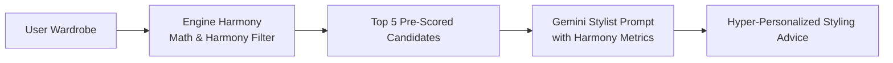

# Engine Harmony — Integration Guide for Developers

This guide provides practical, copy-paste ready examples showing how any developer can integrate `EngineHarmony` into a new or existing Woobi page, 3D Studio, or custom recommendation screen without touching or breaking core files.

---

## 1. Zero-Friction Setup

`Engine Harmony` uses native ECMAScript Modules (ESM) with zero dependencies. It can be imported in:
- Standard browser `<script type="module">`
- Node.js backend services ($\ge \text{v18}$)
- Client-side Web Workers for background generation

### Importing in Frontend Code
```html
<script type="module">
  import { EngineHarmony } from './engine-harmony/index.js';

  const engine = new EngineHarmony();
  console.log("Engine Harmony initialized successfully!");
</script>
```

---

## 2. Scenario 1: Integrating with Woobi Wardrobe Data

Woobi wardrobe items typically have properties like `id`, `name`, `category`, and visual colors. Here is a helper adapter to convert any Woobi wardrobe item into an Engine Harmony compatible garment:

```javascript
// adapters/woobiAdapter.js
export function adaptWoobiGarment(item) {
  return {
    id: item.id || item.uuid || `garment-${Math.random().toString(36).slice(2, 7)}`,
    name: item.name || item.title || 'Wardrobe Item',
    slot: mapCategoryToSlot(item.category || item.type),
    color: item.colorHex || item.color || item.hex || '#808080',
    formality: item.formality || item.style || 'smart_casual',
    pattern: item.pattern || 'solid',
    material: item.material || item.fabric || 'cotton',
    fit: item.fit || 'regular',
    season: item.season || 'all_season',
    condition: item.clean === false ? 'dirty' : 'clean'
  };
}

function mapCategoryToSlot(category = '') {
  const cat = category.toLowerCase();
  if (/shirt|tee|t-shirt|top|sweater|hoodie|polo|blouse/.test(cat)) return 'top';
  if (/pant|jeans|trouser|chino|short|skirt/.test(cat)) return 'bottom';
  if (/shoe|sneaker|boot|loafer|heel|oxford/.test(cat)) return 'shoes';
  if (/jacket|coat|blazer|cardigan|overcoat/.test(cat)) return 'outerwear';
  if (/dress|jumpsuit|romper/.test(cat)) return 'one_piece';
  return 'accessory';
}
```

---

## 3. Scenario 2: Building an "Outfit of the Day" / Recommendations UI

Below is a complete, minimal UI controller that fetches items from a wardrobe, runs `EngineHarmony`, and renders rich recommendation cards.

```javascript
// recommendationPage.js
import { EngineHarmony } from './engine-harmony/index.js';
import { adaptWoobiGarment } from './adapters/woobiAdapter.js';

const engine = new EngineHarmony();

export async function renderRecommendations(rawWardrobeItems, containerElement, options = {}) {
  // 1. Adapt items to Engine Harmony format
  const wardrobe = rawWardrobeItems.map(adaptWoobiGarment);

  // 2. Generate ranked recommendations
  const outfits = engine.recommendOutfits(wardrobe, {
    occasion: options.occasion || 'smart_casual',
    season: options.season || 'all_season',
    maxOutfits: options.maxOutfits || 6,
    diversityThreshold: 0.55
  });

  // 3. Clear container
  containerElement.innerHTML = '';

  if (outfits.length === 0) {
    containerElement.innerHTML = `
      <div class="empty-state">
        <p>No harmonious combinations found with current wardrobe items. Try adding complementary tops or bottoms!</p>
      </div>
    `;
    return;
  }

  // 4. Render recommendation cards
  outfits.forEach((outfit, index) => {
    const card = document.createElement('div');
    card.className = `outfit-card tier-${outfit.tier.toLowerCase()}`;

    const itemsHtml = outfit.items.map(item => `
      <div class="garment-pill" style="border-left: 4px solid ${item.color || '#ccc'}">
        <span class="slot-badge">${item.slot}</span>
        <span class="item-name">${item.name}</span>
      </div>
    `).join('');

    card.innerHTML = `
      <div class="outfit-header">
        <span class="tier-badge">${outfit.tier}</span>
        <span class="score-badge">${Math.round(outfit.overallScore)}/100</span>
      </div>
      <h3 class="outfit-title">${outfit.explanation.title}</h3>
      <p class="outfit-summary">${outfit.explanation.summary}</p>
      <div class="outfit-items-list">
        ${itemsHtml}
      </div>
      <div class="outfit-metrics">
        <span>Color: ${Math.round(outfit.breakdown.colorScore)}</span>
        <span>Harmony: ${outfit.breakdown.harmonyType}</span>
        <span>Contrast: ${outfit.breakdown.contrastRatio}:1</span>
      </div>
      <button class="btn-equip" data-outfit-id="${outfit.id}">
        Equip on Mannequin
      </button>
    `;

    // Hook to 3D Mannequin or Wardrobe display
    card.querySelector('.btn-equip').addEventListener('click', () => {
      if (typeof window.onEquipOutfit === 'function') {
        window.onEquipOutfit(outfit);
      }
    });

    containerElement.appendChild(card);
  });
}
```

---

## 4. Scenario 3: "Complete the Look" (Anchor Item Workflow)

When a user in Woobi's 3D Studio clicks on a garment in the wardrobe (e.g. a Navy Blazer), you can automatically suggest matching bottoms and shoes to build complete outfits around that specific item:

```javascript
// studioLookCompleter.js
import { EngineHarmony } from './engine-harmony/index.js';
import { adaptWoobiGarment } from './adapters/woobiAdapter.js';

const engine = new EngineHarmony();

export function onUserSelectedGarment(selectedItem, allWardrobeItems) {
  const anchor = adaptWoobiGarment(selectedItem);
  const wardrobe = allWardrobeItems.map(adaptWoobiGarment);

  // Complete look around this single anchor
  const completedOutfits = engine.completeOutfit(wardrobe, [anchor], {
    occasion: 'smart_casual',
    maxOutfits: 4
  });

  console.log(`Generated ${completedOutfits.length} complete looks around ${anchor.name}`);
  return completedOutfits;
}
```

---

## 5. Scenario 4: "Swap Item" / Finding Alternatives

When a user likes an outfit but wants to try different shoes or a different jacket:

```javascript
// outfitCustomizer.js
import { EngineHarmony } from './engine-harmony/index.js';
import { adaptWoobiGarment } from './adapters/woobiAdapter.js';

const engine = new EngineHarmony();

export function getAlternativeShoes(currentOutfit, allWardrobeItems) {
  const wardrobe = allWardrobeItems.map(adaptWoobiGarment);

  const alternatives = engine.findAlternativeItems(wardrobe, currentOutfit, 'shoes');

  // Returns array of { item, outfit, deltaScore }
  return alternatives.map(alt => ({
    shoe: alt.item,
    newOverallScore: alt.outfit.overallScore,
    scoreDiff: alt.deltaScore >= 0 ? `+${alt.deltaScore}` : `${alt.deltaScore}`,
    explanation: alt.outfit.explanation.title
  }));
}
```

---

## 6. Scenario 5: Future AI & Gemini Integration Pattern

Engine Harmony can act as the quantitative styling filter and analytical foundation for multimodal LLM or Gemini styling agents:



```javascript
// Example prompt construction for Gemini
function constructGeminiStylistPrompt(outfit) {
  return `
You are a luxury personal stylist. Here is a pre-calculated harmonious outfit:
Items: ${outfit.items.map(i => `${i.name} (${i.color})`).join(', ')}
Chromatic Harmony: ${outfit.breakdown.harmonyType}
Contrast Ratio: ${outfit.breakdown.contrastRatio}:1
Algorithmic Harmony Score: ${Math.round(outfit.overallScore)}/100

Please provide a personalized 2-sentence conversational styling advice on how to wear this look for an evening dinner.
  `.trim();
}
```

---

## 7. Performance Best Practices

1. **Large Wardrobes ($> 100$ items)**:
   - Always filter dirty or damaged clothes first (handled automatically by `recommendOutfits`).
   - If wardrobe size exceeds 250 items, run `recommendOutfits` inside a Web Worker so the UI thread and Three.js 3D rendering loops maintain 60 FPS.
2. **Caching**:
   - Cache color conversions. `ColorParser.resolveColor()` includes an internal dictionary of 50+ fashion swatches for instantaneous $O(1)$ lookups.
3. **No Network Overhead**:
   - Engine Harmony runs 100% locally on the device or server without making any external API calls, ensuring instantaneous offline outfit generation on mobile and desktop.

